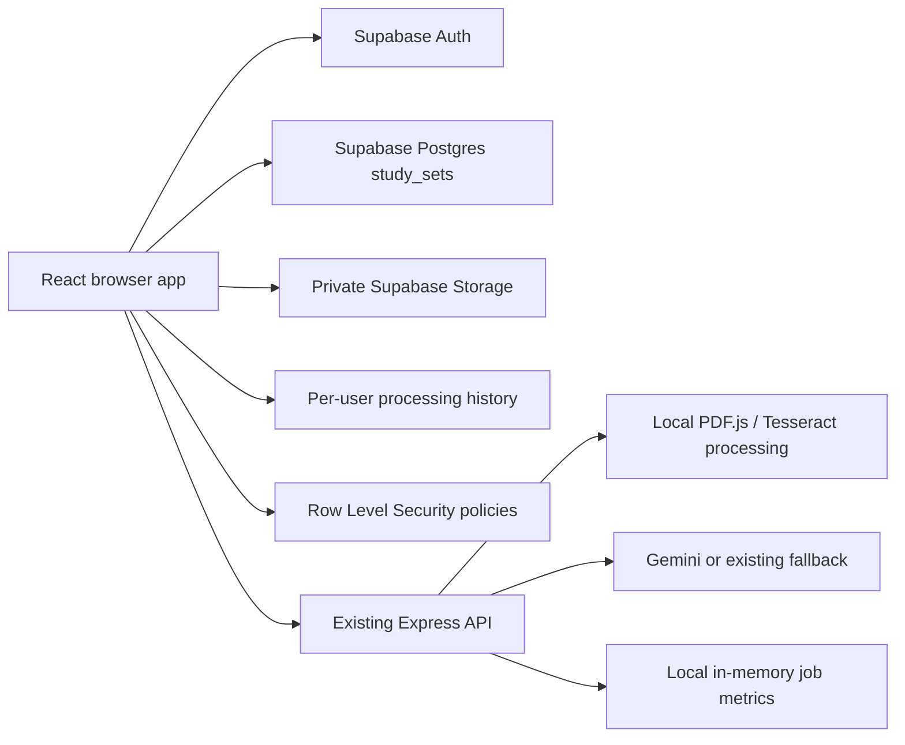

# NoteForge Cloud Upgrade Plan

## Existing architecture

NoteForge is a React + Vite single-page app with an Express API. The API invokes the existing Gemini-or-deterministic-fallback generator and extracts PDF/TXT/image content using PDF.js and Tesseract. The browser stores study sets in localStorage. Vercel configuration remains in place.

## Supabase-enabled architecture



Supabase Auth provides account sign-in. The browser uses the Supabase public anon/publishable key to read and write study sets, with Postgres Row Level Security enforcing per-user access. The service-role key is not used or required.

## Preserved behavior

- Existing React workspace and library remain.
- Existing upload formats, extraction/OCR, summary, quiz, flashcard, scoring, Gemini, and fallback paths are preserved.
- localStorage remains available when signed out, Supabase is not configured, or the project database cannot be used.
- Existing API and Vercel deployment configuration are retained.

## Supabase integration implemented

- Supabase browser client configured using `VITE_SUPABASE_URL` and `VITE_SUPABASE_ANON_KEY`.
- Email/password account registration, sign-in, and sign-out on `/cloud`.
- Study-set persistence with the authenticated user's identity and database row isolation.
- Explicit local library import; matching IDs resolve to the newer `updatedAt` record.
- Save, rename, and delete operations target Supabase for signed-in users.
- Separate browser storage key for a signed-in user's active study set.
- SQL schema and ownership policies documented in `docs/SUPABASE_SETUP.md`.
- Private user-scoped document copies and metadata, when the Storage bucket/policies are configured.
- Persistent per-user records of synchronous processing activity and dashboard aggregates.
- Authenticated users can view and delete their own private document copies.
- Firebase SDKs/configuration removed.

## Not provided by this integration

- Managed background queue: AI and document processing still run synchronously.
- Worker deployment or durable job retries: the local worker is a scaffold and is not connected to Supabase job records.
- Cloud infrastructure telemetry: signed-in dashboard statistics are application activity only, not Supabase or API infrastructure telemetry.
- Production account/project creation: requires the user's Supabase account and project configuration.

## Cost and security

Use Supabase's Free plan only and do not upgrade or enable paid add-ons if the required budget is $0. Free-plan quotas and product terms apply; provider availability and limits may change. No cloud resources are created by the code changes.

The client configuration includes only the public anon/publishable key. The service-role key must never be placed in frontend code. The setup SQL enables RLS with `auth.uid() = user_id` policies for study sets, document metadata, storage objects, and processing history. `.env` and `.env.*` are ignored by Git, except the safe `.env.example`.

## Local commands

```bash
npm install
npm run dev
npm run build
npm run lint
```

See `docs/SUPABASE_SETUP.md` for setup SQL and manual verification. See `docs/DEPLOYMENT_FREE.md` for steps to authorize a manual deployment through the existing Vercel configuration.

## Rollback

To return to local-only mode, clear `VITE_SUPABASE_URL` and `VITE_SUPABASE_ANON_KEY` from `.env`, restart the app, and sign out if signed in. The browser's original local library is not automatically uploaded or overwritten. Do not drop the Supabase table unless you intentionally want to delete the cloud records.
